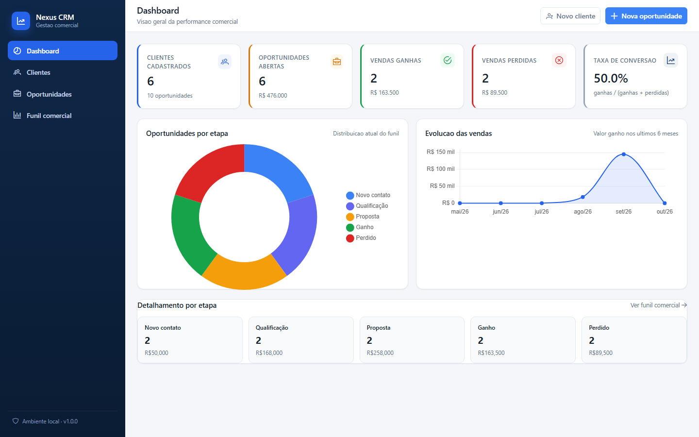
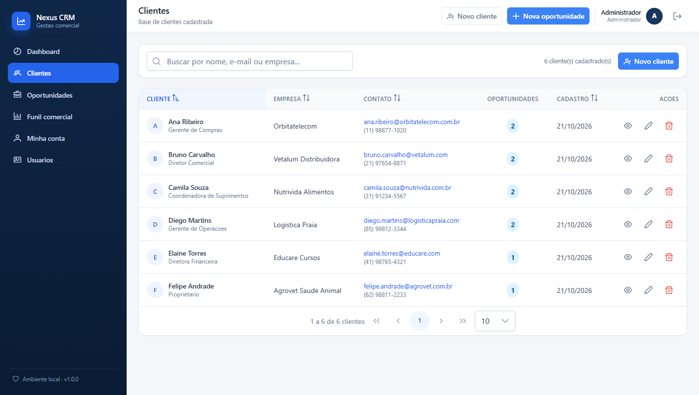
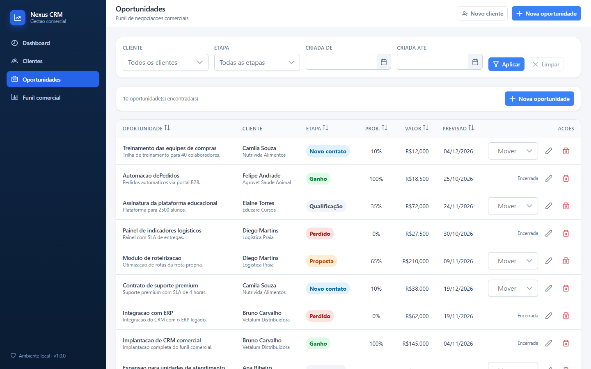
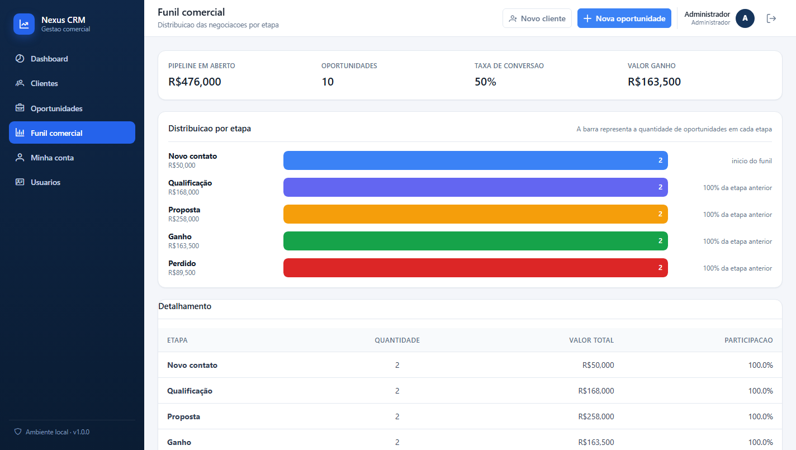
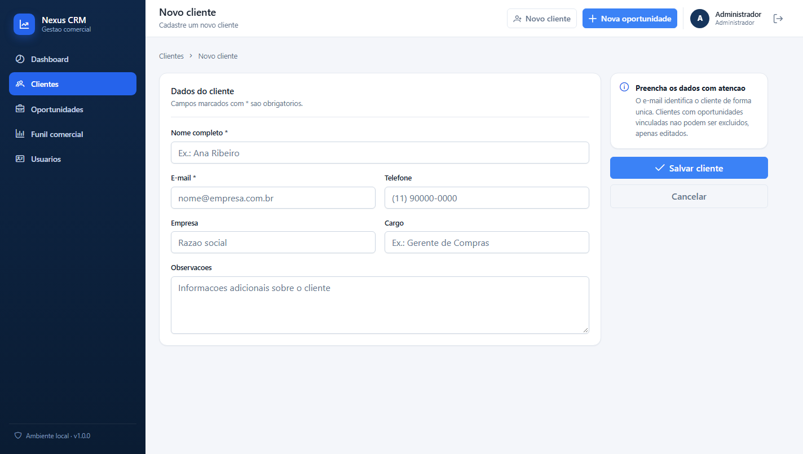
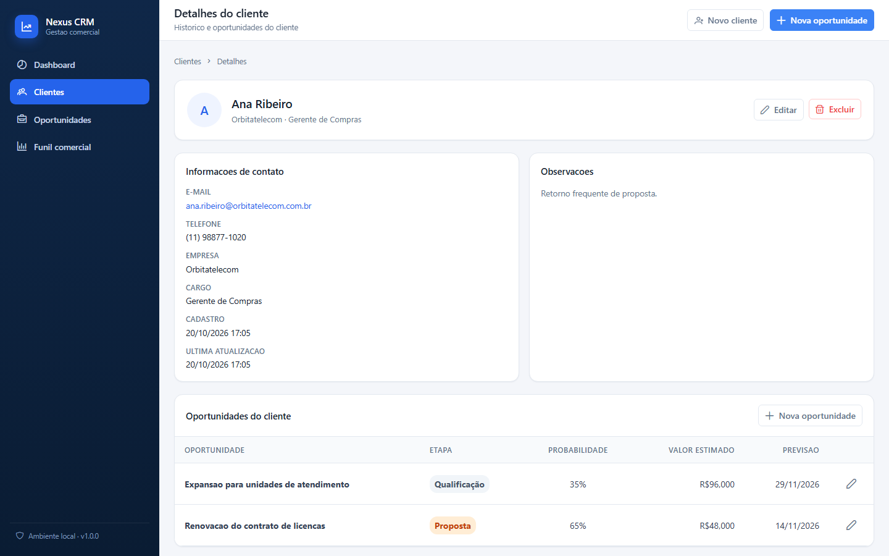
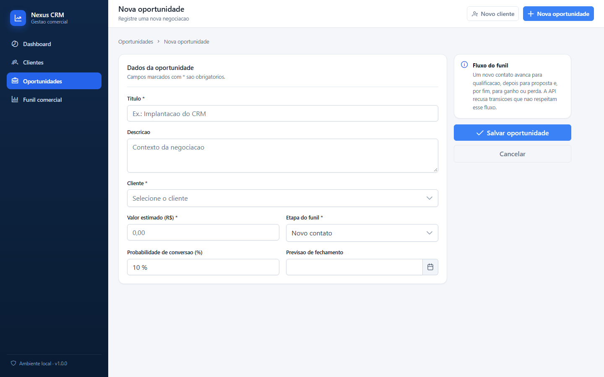
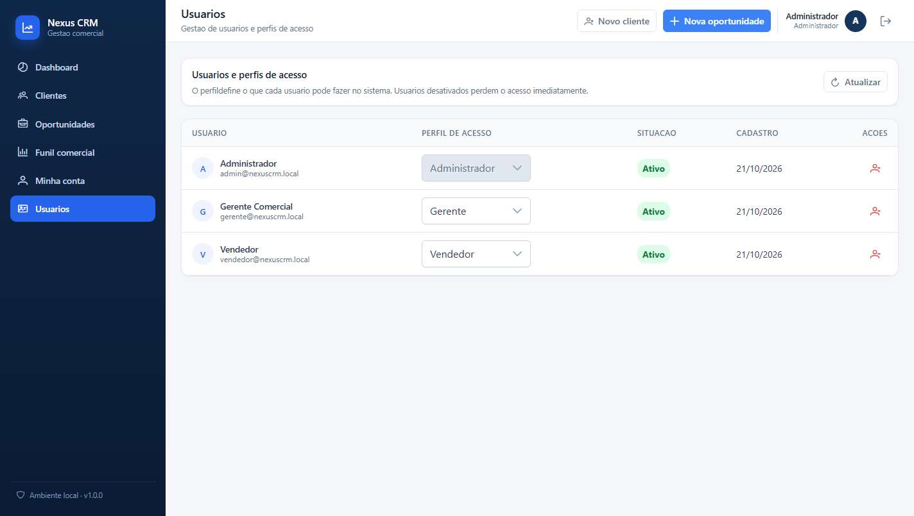
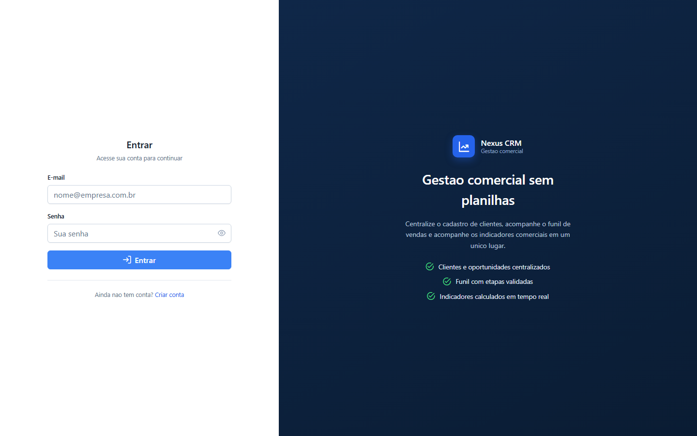

<div align="center">

# Nexus CRM

**Sistema de gestão de clientes e oportunidades de vendas para pequenas e médias empresas.**

Aplicação *full stack* com **Java 21 + Spring Boot 3.5** no back-end, **Angular 20 + PrimeNG 20** no
front-end, autenticação **JWT** com perfis de acesso e banco relacional com **Flyway**.

[](https://openjdk.org/)
[](https://spring.io/projects/spring-boot)
[](https://spring.io/projects/spring-security)
[](https://angular.dev/)
[](https://primeng.org/)
[](https://www.typescriptlang.org/)
[](https://www.postgresql.org/)
[](https://documentation.red-gate.com/flyway)
[](https://vitest.dev/)
[](LICENSE)

</div>

---

## Índice

1. [Visão geral](#1-visão-geral)
2. [Funcionalidades](#2-funcionalidades)
3. [Início rápido](#3-início-rápido)
4. [Autenticação e perfis de acesso](#4-autenticação-e-perfis-de-acesso)
5. [Tecnologias](#5-tecnologias)
6. [Arquitetura](#6-arquitetura)
7. [Banco de dados](#7-banco-de-dados)
8. [API REST](#8-api-rest)
9. [Configuração](#9-configuração)
10. [Execução com Docker](#10-execução-com-docker)
11. [Integração contínua](#11-integração-contínua)
12. [Testes](#12-testes)
13. [Decisões técnicas](#13-decisões-técnicas)
14. [Limitações conhecidas](#14-limitações-conhecidas)
15. [Roadmap](#15-roadmap)
16. [Contribuindo](#16-contribuindo)
17. [Licença](#17-licença)

---

## 1. Visão geral

O Nexus CRM centraliza o relacionamento com clientes e o acompanhamento do funil comercial. A
aplicação cobre o ciclo completo da negociação: cadastro do cliente, registro da oportunidade,
movimentação entre etapas do funil e leitura de indicadores comerciais calculados sobre os dados
realmente persistidos no banco.

> **Princípio da casa:** todo dado exibido na interface vem da API Java. Não há números fixos, listas
> simuladas nem persistência de dados em `localStorage` — o front-end é apenas uma camada de
> apresentação sobre a API REST. O que fica no navegador é somente o **token de acesso** da sessão.

### 1.1 Problema e solução

Pequenas e médias empresas costumam controlar vendas em planilhas, o que gera três problemas
recorrentes:

| Problema | Como o Nexus CRM resolve |
| --- | --- |
| Dados de clientes espalhados em planilhas, com e-mails duplicados | Cadastro centralizado com e-mail único validado no back-end (HTTP 409 em duplicidade) |
| Nenhuma visão do funil: não se sabe quanto está em negociação | Funil por etapa, avanço validado no servidor e histórico de fechamento |
| Decisões sem base: *"quantas vendas fechamos no mês?"* | Dashboard com indicadores calculados por agregações no banco |

### 1.2 Capturas de tela

Capturas reais da aplicação em execução, geradas na pasta `docs/screenshots/`.

| Dashboard | Clientes |
| --- | --- |
|  |  |

| Oportunidades | Funil comercial |
| --- | --- |
|  |  |

| Cadastro de cliente | Detalhes do cliente |
| --- | --- |
|  |  |

| Cadastro de oportunidade | Gestão de usuários (ADMIN) |
| --- | --- |
|  |  |

| Login |
| --- |
|  |

---

## 2. Funcionalidades

### Autenticação e acesso

- Login com e-mail e senha, com emissão de token **JWT** assinado (HMAC-SHA256)
- Cadastro público de novos usuários — o perfil inicial é sempre `VENDEDOR`
- Três perfis de acesso: `ADMIN`, `GERENTE` e `VENDEDOR`
- Proteção de todas as rotas da API **e** da interface (guards de rota)
- Sessão em cookie **HttpOnly**: o token nunca é exposto ao JavaScript, fechando a porta para roubo por XSS
- Proteção **CSRF** por dupla submissão nas operações de escrita
- **Renovação de sessão** com token de uso único rotacionado a cada renovação
- Encerramento de sessão e invalidação **imediata** do acesso ao desativar um usuário
- Senhas gravadas apenas como hash **BCrypt** — nunca em texto puro
- **Troca de senha** pelo próprio usuário, com revogação das outras sessões
- **Recuperação de senha** por link de uso único, válido por uma hora
- Tela de gestão de usuários para troca de perfil e ativação/desativação de contas

### Módulo de clientes

- Cadastro, edição, consulta e exclusão de clientes
- Paginação, ordenação por qualquer coluna e busca por nome, e-mail ou empresa
- Validação de campos obrigatórios e de formato de e-mail
- Bloqueio de e-mail duplicado (HTTP 409) com mensagem clara
- Exclusão bloqueada quando o cliente possui oportunidades vinculadas (HTTP 409)
- Página de detalhes com o histórico de oportunidades do cliente

### Módulo de oportunidades

- Cadastro vinculado obrigatoriamente a um cliente existente
- Valor estimado positivo, probabilidade de conversão (0–100 %) e previsão de fechamento
- Avanço de etapa pelo próprio funil, respeitando o fluxo comercial
- Motivo da perda **obrigatório** ao marcar uma oportunidade como `PERDIDO`
- Filtros por cliente, etapa e período de criação
- Exclusão com confirmação e retorno de 204

### Dashboard e funil

- Total de clientes, oportunidades abertas, vendas ganhas e perdidas
- Valor total do pipeline aberto, valor ganho e valor perdido
- Taxa de conversão com regra documentada: `ganhas / (ganhas + perdidas)`
- Gráfico de distribuição por etapa e evolução mensal das vendas
- Página de funil comercial com a conversão entre etapas

### Transversal

- Tratamento centralizado de erros, com resposta JSON estruturada e única
- Mensagens de sucesso/erro, estados de carregamento e estados de dados vazios
- Interface responsiva (desktop, tablet e celular) e navegação por rotas do Angular
- Documentação interativa da API via OpenAPI/Swagger

---

## 3. Início rápido

### 3.1 Pré-requisitos

| Item | Versão | Observação |
| --- | --- | --- |
| JDK | 21 ou superior | o projeto compila com `--release 21`; validado com JDK 24 |
| Node.js | 20.19+ ou 22.12+ | recomendado 24 LTS; validado com 24.15 |
| npm | 10+ | acompanha o Node.js; validado com 11.12 |
| Maven | 3.9+ | **opcional** — o *maven wrapper* (`mvnw`) é usado no lugar |
| PostgreSQL | 15+ | **opcional** — apenas para o perfil `postgres` |

Não é necessário Docker.

### 3.2 Subindo o back-end

```bash
git clone <url-do-repositorio>
cd nexus-crm/backend

# Modo desenvolvimento: H2 em arquivo, sem nenhuma configuração
./mvnw spring-boot:run                    # Windows: mvnw.cmd spring-boot:run
```

A API sobe em <http://localhost:8080> e o H2 cria o esquema automaticamente na primeira execução.

Com dados de demonstração (6 clientes, 10 oportunidades e os usuários de exemplo):

```bash
./mvnw spring-boot:run -Dspring-boot.run.profiles=dev,demo
```

> **PowerShell:** `.\mvnw.cmd spring-boot:run "-Dspring-boot.run.profiles=dev,demo"`

### 3.3 Subindo o front-end

Em outro terminal:

```bash
cd nexus-crm/frontend
npm install
npm start
```

A aplicação fica disponível em <http://localhost:4200>.

| Script | Descrição |
| --- | --- |
| `npm start` | servidor de desenvolvimento em `http://localhost:4200` |
| `npm run build` | build de produção em `frontend/dist/` |
| `npm run watch` | build contínuo em modo desenvolvimento |
| `npm test` | testes unitários (Vitest) |

### 3.4 Primeiro acesso

| Perfil | E-mail | Senha |
| --- | --- | --- |
| `ADMIN` | `admin@nexuscrm.local` | `Nexus@2026` |
| `GERENTE` | `gerente@nexuscrm.local` | `Vendas@2026` |
| `VENDEDOR` | `vendedor@nexuscrm.local` | `Vendas@2026` |

O administrador é criado na **primeira execução** (carga idempotente) a partir das propriedades
`app.auth.admin.*`. Os usuários `GERENTE` e `VENDEDOR` só existem com o perfil `demo`.

> ⚠️ **Troque a senha do administrador** antes de usar fora do ambiente local.

### 3.5 Endereços locais

| Recurso | Endereço |
| --- | --- |
| Front-end (Angular) | <http://localhost:4200> |
| API REST | <http://localhost:8080/api> |
| Documentação Swagger UI | <http://localhost:8080/swagger-ui.html> |
| OpenAPI (JSON) | <http://localhost:8080/v3/api-docs> |
| Console H2 (perfil `dev`) | <http://localhost:8080/h2-console> — usuário `sa`, senha vazia |

---

## 4. Autenticação e perfis de acesso

### 4.1 Como funciona

A API é **stateless**: cada requisição carrega um token JWT assinado. Não há sessão no servidor, o
que mantém a API horizontalmente escalável. O token pode chegar de duas formas:

| Origem | Quem usa | Como viaja |
| --- | --- | --- |
| Cabeçalho `Authorization: Bearer` | curl, Swagger, integrações | o cliente o envia |
| Cookie `HttpOnly` | a interface web | o navegador o envia sozinho |

Na interface, a sessão **não fica no `localStorage`**: o token viaja num cookie `HttpOnly`, que o
JavaScript da página não consegue ler.

```
        Browser                     API (Spring Security)
   ┌────────────────┐          ┌──────────────────────────────┐
   │  Tela de login │  POST    │  AuthController              │
   │                │─────────▶│  /api/auth/login             │
   │  AuthService   │◀─────────│  valida BCrypt e emite o JWT │
   │  (sem token    │  cookie  │                              │
   │   no JS)       │  HttpOnly│  grava o cookie de sessao    │
   └────────────────┘          │  e o de renovacao            │
          │                     └──────────────────────────────┘
          │  GET /api/clientes
          │  + cookie HttpOnly (automatico)
          │  + X-XSRF-TOKEN (copiado do cookie XSRF-TOKEN)
          ▼
   ┌────────────────┐          ┌──────────────────────────────┐
   │  HttpClient    │─────────▶│  CsrfFilter                  │
   │  + interceptor │          │  valida a dupla submissao    │
   │  + XSRF do     │          ├──────────────────────────────┤
   │    Angular     │          │  FiltroAutenticacaoJwt       │
   └────────────────┘          │  valida a assinatura (HS256) │
                                │  recarrega o usuario do BD   │
                                │  aplica as regras do perfil  │
                                └──────────────────────────────┘
```

Pontos que valem destacar:

- O token é assinado com **HMAC-SHA256** e carrega o e-mail no `sub`, o id em `uid` e os perfis em
  `papeis`.
- **O cookie de sessão é `HttpOnly` e `SameSite=Strict`.** Um XSS não consegue ler a credencial, e
  o navegador não envia o cookie em requisições vindas de outros sites.
- **Toda escrita exige o token de CSRF.** O `HttpClient` do Angular copia o cookie `XSRF-TOKEN`
  para o cabeçalho `X-XSRF-TOKEN`; sem ele, a API responde `403`. As requisições com cabeçalho
  `Authorization` são dispensadas do CSRF, por não dependerem de credencial automática.
- **A renovação é rotacionada.** O token de renovação é um valor opaco guardado apenas como hash
  SHA-256; a cada renovação ele é invalidado e um novo é emitido. Reusar um token já trocado é
  recusado.
- **O usuário é recarregado do banco a cada requisição.** O `ConversorJwtAuthentication` ignora os
  perfis gravados no token: alterar o perfil ou desativar uma conta tem efeito imediato, sem esperar
  a expiração do token.
- A **chave** vive em `app.jwt.secret` e precisa ser um valor aleatório de 32 caracteres ou mais em
  produção.

### 4.2 Matriz de permissões

| Recurso | Público | `VENDEDOR` | `GERENTE` | `ADMIN` |
| --- | :---: | :---: | :---: | :---: |
| `POST /api/auth/login` | ✅ | — | — | — |
| `POST /api/auth/registro` | ✅ | — | — | — |
| `POST /api/auth/refresh` · `/api/auth/logout` | ✅ | — | — | — |
| `POST /api/auth/recuperar-senha` · `/api/auth/redefinir-senha` | ✅ | — | — | — |
| `GET /api/clientes` · `GET /api/clientes/{id}` | ❌ | ✅ | ✅ | ✅ |
| `POST`/`PUT /api/clientes` | ❌ | ✅ | ✅ | ✅ |
| `DELETE /api/clientes/{id}` | ❌ | ❌ | ✅ | ✅ |
| `GET /api/oportunidades` · `GET /api/oportunidades/{id}` | ❌ | ✅ | ✅ | ✅ |
| `POST`/`PUT`/`PATCH /api/oportunidades` | ❌ | ✅ | ✅ | ✅ |
| `DELETE /api/oportunidades/{id}` | ❌ | ❌ | ✅ | ✅ |
| `GET /api/dashboard/**` | ❌ | ✅ | ✅ | ✅ |
| `GET /api/auth/me` | ❌ | ✅ | ✅ | ✅ |
| `GET /api/usuarios` | ❌ | ❌ | ❌ | ✅ |
| `PATCH /api/usuarios/{id}` | ❌ | ❌ | ❌ | ✅ |

> A interface esconde os botões que o usuário não pode usar, mas **quem decide é sempre a API**:
> uma tentativa fora do perfil recebe `403`, mesmo que venha de fora do navegador.

### 4.3 Variáveis de ambiente

Copie `.env.example` para um arquivo de ambiente (fora do repositório) e ajuste os valores:

| Variável | Padrão | Descrição |
| --- | --- | --- |
| `SERVER_PORT` | `8080` | Porta da API |
| `APP_JWT_SECRET` | chave de desenvolvimento | Chave de assinatura do token (mín. 32 caracteres) |
| `APP_JWT_EXPIRACAO_MINUTOS` | `480` | Validade do token de acesso (8 horas) |
| `APP_ADMIN_EMAIL` | `admin@nexuscrm.local` | E-mail do administrador criado na 1ª execução |
| `APP_ADMIN_SENHA` | `Nexus@2026` | Senha do administrador |
| `APP_ADMIN_NOME` | `Administrador` | Nome exibido do administrador |
| `DB_URL` | — | JDBC do PostgreSQL (perfil `postgres`) |
| `DB_USERNAME` | — | Usuário do PostgreSQL |
| `DB_PASSWORD` | — | Senha do PostgreSQL |
| `APP_SESSION_COOKIE_SECURE` | `false` | marca os cookies como `Secure` (ligue em produção) |
| `APP_SESSION_COOKIE_SAME_SITE` | `Strict` | política `SameSite` dos cookies |
| `APP_SESSION_REFRESH_DIAS` | `7` | validade do token de renovação |
| `APP_RECUPERACAO_URL` | `http://localhost:4200` | base do link de recuperação de senha |
| `APP_RECUPERACAO_VALIDADE_MINUTOS` | `60` | validade do token de recuperação |
| `SPRING_MAIL_HOST` | — | SMTP para o envio dos e-mails (opcional) |

---

## 5. Tecnologias

### Back-end

| Tecnologia | Versão | Papel |
| --- | --- | --- |
| Java | 21 | linguagem principal (compila com `--release 21`) |
| Spring Boot | 3.5 | framework da aplicação |
| Spring Web | 3.5 | API REST |
| Spring Data JPA | 3.5 | persistência e repositórios |
| Spring Validation | 3.5 | validação de entrada (Bean Validation) |
| Spring Security | 6.5 | autenticação, autorização e criptografia de senha |
| Spring Security OAuth2 Resource Server | 6.5 | validação do token JWT (HMAC-SHA256) |
| Hibernate ORM | 6.6 | mapeamento objeto-relacional (sempre com `ddl-auto=validate`) |
| Springdoc OpenAPI | 2.8 | documentação Swagger |
| Flyway | 11 | versionamento do esquema por *vendor* |
| H2 | 2.3 | banco padrão de desenvolvimento (arquivo) |
| PostgreSQL | 15+ | banco recomendado para uso contínuo |
| Tomcat embutido | 11 | servidor HTTP na porta 8080 |
| Maven | 3.9 | build (via *maven wrapper*) |
| JUnit 5 + Mockito | 5.x | testes unitários |
| Spring Boot Test | 3.5 | testes de integração (MockMvc) |
| Maven Failsafe | 3.5 | execução dos testes de integração no `verify` |

### Front-end

| Tecnologia | Versão | Papel |
| --- | --- | --- |
| Angular | 20 | framework (standalone components, signals) |
| TypeScript | 5.9 | tipagem |
| PrimeNG | 20 | componentes de UI (tabelas, formulários, diálogo, toast, select) |
| PrimeIcons | 7 | ícones |
| Chart.js | 4.5 | gráficos do dashboard |
| RxJS | 7.8 | Observables e `HttpClient` |
| Zone.js | 0.15 | detecção de mudanças |
| SCSS | — | estilização e *design tokens* |
| Vitest | 3.2 | testes unitários |
| jsdom | 25 | DOM simulado nos testes |
| Angular CLI / `@angular/build` | 20.3 | build (esbuild) e dev server |
| npm | 11 | gerenciador de pacotes |

---

## 6. Arquitetura

### 6.1 Visão geral

```
 Navegador
    │  HTTP/JSON
    ▼
┌──────────────────────────────────────────────┐
│  Front-end (Angular 20)                      │
│  Pages (standalone) → Services → HttpClient   │
│  Guards (sessão e perfil) + Interceptor (JWT) │
└──────────────────────────────────────────────┘
    │  REST  /api/auth · /api/clientes · /api/oportunidades · /api/dashboard · /api/usuarios
    ▼
┌──────────────────────────────────────────────┐
│  Back-end (Spring Boot 3.5)                  │
│  SecurityFilterChain → Controller → Service   │
│  → Repository → JPA     DTO ⇄ Entity (Mapper) │
└──────────────────────────────────────────────┘
    │  JDBC
    ▼
    Banco (H2 em desenvolvimento / PostgreSQL)
```

### 6.2 O caminho de uma requisição

1. **SecurityFilterChain** — valida a assinatura do token, recarrega o usuário e verifica o perfil.
2. **Controller** (`controller/`) — recebe a requisição HTTP, valida o corpo com `@Valid` e devolve
   DTOs. Não contém regra de negócio.
3. **Service** (`service/`) — contém as regras de negócio: e-mail duplicado, exclusão de cliente com
   oportunidades, transições válidas de etapa, cálculo dos indicadores.
4. **Repository** (`repository/`) — interfaces `JpaRepository` com consultas JPQL nomeadas.
5. **Banco** — tabelas `clientes`, `oportunidades` e `usuarios` criadas por migrations do Flyway.
6. **Mapper** (`mapper/`) — converte DTO ↔ entidade, evitando expor entidades JPA na API.

### 6.3 Organização do back-end

```
backend/src/main/java/com/nexus/crm/
├── config/        CORS, OpenAPI, SecurityConfig e cargas iniciais
├── controller/    Endpoints REST (auth, clientes, oportunidades, dashboard, usuários)
├── service/       Regras de negócio e cálculo de indicadores
├── repository/    Consultas ao banco (Spring Data JPA)
├── model/         Entidades JPA, enumeração de etapas e de perfis de acesso
├── dto/           Records de entrada e saída da API
├── mapper/        Conversão entre DTO e entidade
├── security/      Emissão e conversão do token JWT, usuário autenticado
├── exception/     Exceções de domínio e tratamento global de erros
└── NexusCrmApplication.java
```

### 6.4 Organização do front-end

```
frontend/src/app/
├── core/
│   ├── models/       Interfaces TypeScript dos dados da API
│   ├── services/     ClienteService, OportunidadeService, DashboardService, AuthService, UsuarioService
│   ├── guards/       Proteção de rotas por sessão e por perfil de acesso
│   ├── interceptors/ Envio do token de acesso no cabeçalho Authorization
│   ├── theme/        Preset de tema do PrimeNG
│   └── utils/        Extração de mensagens de erro da API
├── layout/           Menu lateral + cabeçalho (shell da aplicação)
├── features/
│   ├── auth/         Telas de login e cadastro
│   ├── dashboard/    Indicadores e gráficos
│   ├── clientes/     Lista, cadastro e detalhes
│   ├── oportunidades/ Lista e cadastro
│   ├── funil/        Funil comercial
│   ├── usuarios/     Gestão de usuários (restrito ao ADMIN)
│   └── erro/         Página de rota inexistente
├── environments/    URL da API por ambiente
└── app.routes.ts    Rotas da aplicação
```

### 6.5 Estrutura de pastas

```
nexus-crm/
├── backend/                  API REST (Spring Boot)
│   ├── mvnw / mvnw.cmd       Maven wrapper (não exige Maven instalado)
│   ├── pom.xml
│   └── src/
│       ├── main/java/com/nexus/crm/...
│       ├── main/resources/
│       │   ├── application*.properties
│       │   └── db/migration/{h2,postgresql}/   scripts do Flyway
│       └── test/java/com/nexus/crm/...
├── frontend/                 Aplicação web (Angular)
│   ├── package.json
│   ├── angular.json
│   └── src/app/...
├── docs/
│   └── screenshots/          Capturas de tela reais da aplicação
├── .env.example              Modelo de variáveis de ambiente
├── .gitignore
└── README.md
```

---

## 7. Banco de dados

### 7.1 Perfis

| Perfil | Banco | `ddl-auto` | Quando usar |
| --- | --- | --- | --- |
| `dev` (padrão) | H2 em arquivo | `validate` | primeira execução, demonstrações |
| `postgres` | PostgreSQL | `validate` | desenvolvimento contínuo / produção |
| `demo` | o do perfil acima | — | adiciona a carga de dados de exemplo |

O perfil `dev` usa um banco H2 em arquivo:

```
jdbc:h2:file:./data/nexusdb;AUTO_SERVER=TRUE;DB_CLOSE_DELAY=-1
```

> O banco H2 de desenvolvimento fica em `backend/data/nexusdb.mv.db` (pasta ignorada pelo Git).
> Para começar do zero, apague a pasta `backend/data`.

### 7.2 PostgreSQL

```bash
# 1. Criar o banco e o usuário
sudo -u postgres psql -c "CREATE DATABASE nexus_crm;"
sudo -u postgres psql -c "CREATE USER nexus WITH PASSWORD 'nexus';"
sudo -u postgres psql -c "GRANT ALL PRIVILEGES ON DATABASE nexus_crm TO nexus;"

# 2. Exportar as credenciais (fora do repositório)
export DB_URL=jdbc:postgresql://localhost:5432/nexus_crm
export DB_USERNAME=nexus
export DB_PASSWORD=nexus

# 3. Executar com o perfil postgres
./mvnw spring-boot:run -Dspring-boot.run.profiles=postgres
```

### 7.3 Migrations

As migrations são aplicadas automaticamente pelo Flyway. O esquema **nunca** é criado por
`ddl-auto=update`: nos dois bancos o `ddl-auto` é `validate`, e as *scripts* versionadas em
`backend/src/main/resources/db/migration/{h2,postgresql}` são a única fonte do esquema.

| Versão | Script | Conteúdo |
| --- | --- | --- |
| `V1` | `criar_esquema_inicial` | tabelas `clientes` e `oportunidades` |
| `V2` | `criar_tabela_usuarios` | tabela `usuarios` (autenticação e perfis) |

O placeholder `{vendor}` em `spring.flyway.locations` seleciona automaticamente os scripts de H2 ou
de PostgreSQL, sem duplicar lógica de configuração.

### 7.4 Modelo de dados

```
clientes                          oportunidades                      usuarios
┌────────────────────┐            ┌────────────────────┐            ┌────────────────────┐
│ id          PK     │            │ id           PK    │            │ id          PK     │
│ nome        NOT NULL│            │ titulo       NOT NULL│            │ nome        NOT NULL│
│ email       NOT NULL│◀──────────│ cliente_id   FK    │            │ email       NOT NULL│
│ telefone            │         1N │ valor_estimado NOT NULL│            │ senha_hash  NOT NULL│
│ empresa             │            │ etapa        NOT NULL│            │ papel       NOT NULL│
│ cargo               │            │ probabilidade       │            │ ativo       NOT NULL│
│ observacoes         │            │ data_criacao        │            │ data_criacao        │
│ data_cadastro       │            │ data_prevista_fech. │            └────────────────────┘
│ data_atualizacao    │            │ data_fechamento     │                   uk_usuarios_email
└────────────────────┘            │ motivo_perda        │                   ck_usuarios_papel
      uk_clientes_email           └────────────────────┘
```

Regras aplicadas no banco:

- `clientes.email` é único (`uk_clientes_email`)
- `usuarios.email` é único (`uk_usuarios_email`)
- `usuarios.papel` só aceita `ADMIN`, `GERENTE` ou `VENDEDOR` (`ck_usuarios_papel`)
- `oportunidades.valor_estimado` deve ser positivo (`ck_oportunidades_valor`)
- `oportunidades.probabilidade` fica entre 0 e 100 (`ck_oportunidades_probabilidade`)

---

## 8. API REST

### 8.1 Convenções

- Prefixo único: `/api`
- Paginação no padrão Spring Data (`page`, `size`, `sort`)
- Datas e valores monetários em ISO-8601 (`2026-12-20`) e `BigDecimal` (`48000.00`)
- Exclusão responde `204 No Content`
- Erros respondem sempre o mesmo envelope JSON (ver [8.3](#83-formato-de-erro))

### 8.2 Endpoints

| Método | Rota | Descrição | Acesso |
| --- | --- | --- | --- |
| `POST` | `/api/auth/login` | Autentica e abre a sessão | público |
| `POST` | `/api/auth/registro` | Cadastra um novo usuário (`VENDEDOR`) | público |
| `POST` | `/api/auth/refresh` | Renova a sessão e rotaciona o token | público |
| `POST` | `/api/auth/logout` | Encerra a sessão e revoga o token | público |
| `POST` | `/api/auth/recuperar-senha` | Envia o link de recuperação | público |
| `POST` | `/api/auth/redefinir-senha` | Redefine a senha com o token | público |
| `POST` | `/api/auth/trocar-senha` | Troca a senha do usuário autenticado | autenticado |
| `GET` | `/api/auth/me` | Dados do usuário autenticado | autenticado |
| `GET` | `/api/clientes` | Lista com paginação, ordenação e busca | autenticado |
| `GET` | `/api/clientes/{id}` | Consulta um cliente | autenticado |
| `GET` | `/api/clientes/{id}/oportunidades` | Oportunidades de um cliente | autenticado |
| `POST` | `/api/clientes` | Cadastra um cliente | autenticado |
| `PUT` | `/api/clientes/{id}` | Atualiza um cliente | autenticado |
| `DELETE` | `/api/clientes/{id}` | Exclui um cliente | `ADMIN`, `GERENTE` |
| `GET` | `/api/oportunidades` | Lista com filtros | autenticado |
| `GET` | `/api/oportunidades/{id}` | Consulta uma oportunidade | autenticado |
| `POST` | `/api/oportunidades` | Cadastra uma oportunidade | autenticado |
| `PUT` | `/api/oportunidades/{id}` | Atualiza uma oportunidade | autenticado |
| `PATCH` | `/api/oportunidades/{id}/etapa` | Avança a etapa do funil | autenticado |
| `DELETE` | `/api/oportunidades/{id}` | Exclui uma oportunidade | `ADMIN`, `GERENTE` |
| `GET` | `/api/dashboard/resumo` | Indicadores consolidados | autenticado |
| `GET` | `/api/dashboard/oportunidades-por-etapa` | Distribuição por etapa | autenticado |
| `GET` | `/api/dashboard/vendas-por-periodo` | Evolução mensal das vendas | autenticado |
| `GET` | `/api/usuarios` | Lista os usuários | `ADMIN` |
| `PATCH` | `/api/usuarios/{id}` | Altera perfil ou situação | `ADMIN` |

A documentação completa e interativa fica em <http://localhost:8080/swagger-ui.html>.

### 8.3 Formato de erro

Todas as falhas usam o mesmo envelope, tratado de forma centralizada por `GlobalExceptionHandler`:

```json
{
  "timestamp": "2026-10-20T17:05:58.530",
  "status": 409,
  "erro": "Conflito de regra de negocio",
  "mensagem": "Transicao invalida: nao e possivel mover a oportunidade de Novo contato para Ganho.",
  "caminho": "/api/oportunidades/11/etapa",
  "campos": {}
}
```

| Código | Situação |
| --- | --- |
| 200 / 201 / 204 | sucesso |
| 400 | payload inválido (campos detalhados em `campos`) |
| 401 | sem token, token inválido ou expirado, credenciais inválidas |
| 403 | usuário autenticado sem o perfil exigido para a operação |
| 404 | recurso inexistente |
| 409 | e-mail duplicado, cliente com oportunidades, transição inválida |

### 8.4 Exemplos de requisições

```bash
# Login (devolve o token de acesso)
TOKEN=$(curl -s -X POST http://localhost:8080/api/auth/login \
  -H "Content-Type: application/json" \
  -d '{"email":"admin@nexuscrm.local","senha":"Nexus@2026"}' | jq -r .token)

# Listar clientes com paginação, ordenação e busca
curl "http://localhost:8080/api/clientes?termo=ana&page=0&size=10&sort=nome,asc" \
  -H "Authorization: Bearer $TOKEN"

# Cadastrar um cliente
curl -X POST http://localhost:8080/api/clientes \
  -H "Authorization: Bearer $TOKEN" \
  -H "Content-Type: application/json" \
  -d '{
        "nome": "Ana Ribeiro",
        "email": "ana.ribeiro@empresa.com.br",
        "telefone": "(11) 98877-1020",
        "empresa": "Orbitatelecom",
        "cargo": "Gerente de Compras",
        "observacoes": "Prefere contato por e-mail."
      }'

# Cadastrar uma oportunidade
curl -X POST http://localhost:8080/api/oportunidades \
  -H "Authorization: Bearer $TOKEN" \
  -H "Content-Type: application/json" \
  -d '{
        "titulo": "Renovacao do contrato de licencas",
        "descricao": "Contrato anual para 120 usuarios.",
        "clienteId": 1,
        "valorEstimado": 48000.00,
        "etapa": "NOVO_CONTATO",
        "probabilidade": 10,
        "dataPrevistaFechamento": "2026-12-20"
      }'

# Avançar a etapa (409 em transições inválidas)
curl -X PATCH http://localhost:8080/api/oportunidades/1/etapa \
  -H "Authorization: Bearer $TOKEN" \
  -H "Content-Type: application/json" \
  -d '{"etapa":"QUALIFICACAO"}'

# Marcar como perdida (motivo obrigatório)
curl -X PATCH http://localhost:8080/api/oportunidades/1/etapa \
  -H "Authorization: Bearer $TOKEN" \
  -H "Content-Type: application/json" \
  -d '{"etapa":"PERDIDO","motivoPerda":"Escolheu a concorrencia"}'

# Indicadores do dashboard
curl http://localhost:8080/api/dashboard/resumo -H "Authorization: Bearer $TOKEN"
```

---

## 9. Configuração

### 9.1 Perfis do Spring Boot

| Perfil | Ativação | Efeito |
| --- | --- | --- |
| `dev` | padrão (`spring.profiles.default=dev`) | H2 em arquivo, console H2 habilitado |
| `demo` | `-Dspring-boot.run.profiles=dev,demo` | carga de dados e usuários de exemplo |
| `postgres` | `-Dspring-boot.run.profiles=postgres` | PostgreSQL em vez de H2 |
| `test` | automático nos testes | H2 em memória, Flyway aplicado no arranque |

### 9.2 CORS

Os endereços do front-end autorizados a chamar a API ficam em `app.cors.origins`, separados por
vírgula:

```properties
app.cors.origins=http://localhost:4200,http://127.0.0.1:4200
```

Se o front-end rodar em outra porta ou domínio, altere essa propriedade **e** a `apiUrl` em
`frontend/src/app/environments/environment.development.ts`.

### 9.3 Front-end

| Ambiente | Arquivo | Campo |
| --- | --- | --- |
| Desenvolvimento | `frontend/src/app/environments/environment.development.ts` | `apiUrl` |
| Produção | `frontend/src/app/environments/environment.ts` | `apiUrl` |

### 9.4 Gerar as capturas de tela

```bash
# 1. subir a API com dados de exemplo
cd backend && ./mvnw spring-boot:run -Dspring-boot.run.profiles=dev,demo

# 2. subir o front-end
cd frontend && npm start

# 3. capturar a tela de login (não exige sessão)
chrome --headless=new --disable-gpu --hide-scrollbars \
  --window-size=1440,900 --virtual-time-budget=8000 \
  --screenshot=docs/screenshots/login.png http://localhost:4200/login
```

> As telas internas exigem sessão: faça o login no navegador antes de capturar, ou use um perfil do
> Chrome já autenticado.

---

## 10. Execução com Docker

O projeto traz *multi-stage builds* e um `docker-compose.yml` que sobe a stack completa: PostgreSQL,
a API (Spring Boot) e a interface (Angular servido por nginx).

```bash
# 1. copie as variaveis e ajuste os segredos
cp .env.example .env

# 2. suba a stack
docker compose up --build

# 3. acompanhe os logs
docker compose logs -f api
```

| Serviço | Endereço |
| --- | --- |
| Interface web | <http://localhost:4200> |
| API REST | <http://localhost:8080/api> |
| Health da API | <http://localhost:8080/actuator/health> |

> O perfil `prod` é ativado no `docker-compose.yml`. Por isso a API **recusa subir** se
> `APP_JWT_SECRET` ou `APP_ADMIN_SENHA` ainda forem os valores de desenvolvimento — o
> `docker-compose.yml` exige que ambos estejam definidos no `.env`.

| Arquivo | Papel |
| --- | --- |
| `backend/Dockerfile` | build do JAR e imagem mínima com JRE |
| `frontend/Dockerfile` | build do bundle e imagem com nginx |
| `frontend/nginx.conf` | servidor estático com fallback para o `index.html` |
| `docker-compose.yml` | stack completa com PostgreSQL, API e interface |

---

## 11. Integração contínua

O pipeline em `.github/workflows/ci.yml` roda a cada push na `main` e em cada pull request:

| Job | O que faz |
| --- | --- |
| `backend` | compila, roda os testes unitários e de integração, publica o JAR |
| `frontend` | instala as dependências, roda os testes e o build, publica o bundle |
| `security` | `npm audit` com falha em vulnerabilidades altas |
| `docker` | constrói as duas imagens, garantindo que o Dockerfile continua válido |

---

## 12. Testes

### 12.1 Como executar

```bash
# Back-end: unitários (JUnit 5 + Mockito) e integração (MockMvc + H2 em memória)
cd backend
./mvnw test        # apenas testes unitários
./mvnw verify      # unitários + integração (Failsafe)

# Front-end: unitários com Vitest
cd frontend
npm test
```

### 12.2 Resultados da última execução

Executados localmente com JDK 24 (compilando com `--release 21`), Maven 3.9.9, Node 24.15 e
Angular CLI 20:

| Projeto | Comando | Resultado |
| --- | --- | --- |
| Back-end (unitários) | `./mvnw test` | **16 testes**, 0 falhas — `BUILD SUCCESS` |
| Back-end (integração) | `./mvnw verify` | **47 testes**, 0 falhas — `BUILD SUCCESS` |
| Front-end | `npm test` | **35 testes**, 0 falhas — 7 arquivos de teste |
| Front-end (build) | `npm run build` | bundle de 1,56 MB (322 kB gzip), sem erros |

**Total: 98 verificações automatizadas, todas passando.**

### 12.3 O que é coberto

**Regras de negócio** — cadastro válido, validação de campos inválidos, e-mail duplicado, cliente
inexistente, exclusão bloqueada com oportunidades, cadastro de oportunidade, valor inválido,
cliente inexistente na oportunidade, transição para ganho, transição para perda com motivo
obrigatório, transição inválida, reabertura de oportunidade ganha e os cálculos do dashboard
(inclusive o caso sem dados, sem divisão por zero).

**Autenticação e autorização** — login com credenciais válidas, senha incorreta, e-mail inexistente
e usuário desativado; cadastro público, e-mail duplicado e senha fraca; exigência de token nas
rotas protegidas e recusa de token inválido; perfil `VENDEDOR` bloqueado na exclusão (HTTP 403) e
`GERENTE` autorizado; gestão de usuários restrita ao `ADMIN`; e desativação de um usuário
derrubando o acesso da sessão na hora.

**Sessão, CSRF e renovação** — o login grava os cookies `HttpOnly` com o caminho correto; a
sessão por cookie autentica a requisição; uma escrita sem o token de CSRF é recusada (HTTP 403) e
com o token é aceita; a renovação emite um cookie novo e invalida o anterior; a troca de senha
altera o hash, recusa senha repetida e exige a senha atual correta.

**Recuperação de senha** — o pedido responde `202` mesmo para e-mail inexistente (sem enumeração de
usuários); o token é criado para usuário ativo, é recusado quando inválido e não pode ser reutilizado;
a redefinição troca a senha.

**Front-end** — modelo de oportunidade e suas transições, extração de mensagens de erro da API
(incluindo 401 e 403), serviço de clientes com paginação e busca, formulário de cliente,
dashboard com indicadores reais e o novo `AuthService` (login, registro, logout e perfis).

### 12.4 Estratégia

| Tipo | Escopo | Ferramenta |
| --- | --- | --- |
| Unitário | regras de negócio isoladas, sem Spring | JUnit 5 + Mockito |
| Integração | contexto Spring completo, HTTP de verdade | MockMvc + H2 em memória |
| Unitário (front) | serviços, models e componentes | Vitest + jsdom |

Os testes de integração **emitem tokens JWT reais** para usuários criados no banco, de modo que o
filtro de segurança, o conversor do token e as regras de perfil sejam exercitados de ponta a ponta
— e não simulados.

---

## 13. Decisões técnicas

**Java 21 com registros (`record`) para DTOs.**
DTOs imutáveis, com validação declarativa (`@NotBlank`, `@Email`, `@DecimalMin`, `@Pattern`). Menos
boilerplate e contrato da API explícito.

**Entidades JPA nunca são expostas nos endpoints.**
O contrato público é a coleção de DTOs em `dto/`. A conversão fica em `mapper/`, o que evita expor
detalhes de persistência (lazy loading, nomes de colunas) e facilita a evolução do modelo.

**Exclusão de cliente com oportunidades é bloqueada (409).**
Apagar em cascata destruiria o histórico comercial. A API recusa a operação com uma mensagem
explícita, e o front-end apenas exibe o erro devolvido.

**Fluxo do funil validado no back-end.**
`EtapaOportunidade.permiteTransicaoPara()` define as transições permitidas
(`NOVO_CONTATO → QUALIFICACAO → PROPOSTA → GANHO | PERDIDO`). O front-end espelha a mesma regra em
`proximasEtapas()` para não oferecer opções inválidas, mas a decisão final é sempre do back-end.

**Flyway com migrations por banco.**
`spring.flyway.locations=classpath:db/migration/{vendor}` seleciona automaticamente os scripts de H2
ou PostgreSQL. O esquema é versionado e auditável; `ddl-auto=validate` impede que o Hibernate
altere o esquema por conta própria.

**Erros tratados de forma centralizada.**
`GlobalExceptionHandler` converte exceções de domínio, validação do Bean Validation e erros de
integridade em uma resposta JSON única (`timestamp`, `status`, `erro`, `mensagem`, `caminho`,
`campos`), que o front-end consome em `mensagemErro()`.

**Indicadores calculados no banco, não no front-end.**
O dashboard usa agregações (`COUNT`, `SUM`, `GROUP BY`) via JPQL. Números fixos ou aleatórios seriam
desatualizados e falseariam a análise.

**Sinais e `inject()` no Angular.**
`signal` para estado local das telas e `computed` para valores derivados (KPIs, séries dos gráficos
e permissões). Evita `subscribe` manual e mudanças de detecção desnecessárias.

**Componentes standalone e rotas lazy por módulo.**
Cada tela é um componente standalone com seu próprio HTML/SCSS, importando apenas o PrimeNG que
utiliza. O bundle inicial fica em ~319 kB (gzipped) apesar da biblioteca de UI completa.

**Autenticação stateless com token JWT.**
A API não guarda sessão: cada requisição carrega um token assinado com HMAC-SHA256 no cabeçalho
`Authorization`. Isso mantém a API horizontalmente escalável e evita o acoplamento do back-end com
a origem do front-end.

**O usuário é recarregado do banco a cada requisição.**
`ConversorJwtAuthentication` ignora os perfis gravados no token e busca o usuário novamente. Assim,
alterar o perfil de acesso ou desativar um usuário tem efeito imediato, sem esperar a expiração do
token.

**As regras de autorização ficam centralizadas.**
O `SecurityConfig` define, em um único lugar, quais rotas exigem sessão e quais exigem um perfil
específico. A interface apenas esconde os botões que o usuário não pode usar — mas quem decide é
sempre a API, que responde `403` se a operação for tentada de qualquer forma.

**A sessão vive num cookie HttpOnly, não no `localStorage`.**
O token de acesso viaja num cookie `HttpOnly` e `SameSite=Strict`, invisível ao JavaScript: um
eventual XSS nao consegue ler a credencial. O token de renovação é um valor opaco guardado apenas
como hash SHA-256, rotacionado a cada uso — reusar um token já trocado é recusado.

**O CSRF é aplicado de fato às requisições por cookie.**
A interface envia o cookie `XSRF-TOKEN` no cabeçalho `X-XSRF-TOKEN` (dupla submissão) em toda
operação de escrita. Para que isso fosse possível, o filtro de autenticação do projeto é próprio
(`FiltroAutenticacaoJwt`), em vez do filtro de resource server do Spring Security: este último
isenta automaticamente do CSRF qualquer requisição que carregue o token, o que desativaria a
proteção justamente nas requisições autenticadas por cookie.

**A aplicação se recusa a subir com segredos de desenvolvimento.**
Fora dos perfis `dev` e `test`, a inicialização falha se a chave JWT ou a senha do administrador
ainda forem as de desenvolvimento. Uma falha cedo e explícita é muito melhor do que um ambiente
exposto.

**Senhas nunca são gravadas em texto puro.**
O `BCryptPasswordEncoder` calcula o hash no cadastro e o compara no login. O hash é o que vai para
o banco; a senha em claro nunca é persistida nem devolvida pela API.

**Cadastro público só cria `VENDEDOR`.**
Promover um usuário a gerente ou administrador é uma ação restrita ao `ADMIN`, feita pela tela de
gestão de usuários. Isso evita que qualquer pessoa se auto-promova pela tela de cadastro.

---

## 14. Limitações conhecidas

- **A renovação depende do cookie de sessão.** A política `SameSite=Strict` exige que a API e o
  front-end fiquem no mesmo site. Em domínios diferentes, use `SameSite=None` com `Secure` (e HTTPS).
- **O e-mail de recuperação depende de SMTP.** Sem `spring.mail.host` configurado, o link é
  registrado no log da API em vez de ser enviado — o fluxo funciona, mas não chega ao usuário.
- **Sem histórico de auditoria.** Os registros não guardam *quem* criou ou alterou cada cliente e
  oportunidade, apenas as datas.
- **Sem segregação de dados por vendedor.** Todos os usuários autenticados veem a base completa de
  clientes e oportunidades; o perfil `VENDEDOR` apenas não pode excluir registros.
- **Busca textual simples.** A busca de clientes usa `LIKE` sobre três campos; não há busca
  *full-text* nem tolerância a erros de digitação.
- **Relatórios são apenas os do dashboard.** Não há exportação para CSV/PDF nem relatórios
  parametrizáveis.
- **Validação de data prevista.** A API recusa datas de fechamento no passado apenas no `POST`/`PUT`;
  o front-end também aplica esse limite no seletor de data.
- **Sem deploy containerizado.** O projeto foi pensado para execução local, sem Docker.
- **Dependências de desenvolvimento com alertas de segurança.** O `npm audit` aponta avisos em
  `vitest`/`tinypool` (somente no ambiente de testes). O código de produção não é afetado; a correção
  exige a migração para o Vitest 5, ainda não suportado pelo builder do Angular 20.

---

## 15. Roadmap

- [ ] Cookie de sessão com `SameSite=None` para implantações em domínios diferentes
- [ ] Envio de e-mail transacional (recuperação de senha, convites)
- [ ] Registro de auditoria (quem criou ou alterou cada registro)
- [ ] Segregação de dados: cada vendedor vê apenas os próprios clientes e oportunidades
- [ ] Relatórios exportáveis (CSV) e metas por mês/seller
- [ ] E-mail de acompanhamento automático ao cliente e ao vendedor
- [ ] Importação de contatos via CSV
- [ ] Testes end-to-end com Cypress/Playwright sobre a aplicação real
- [ ] Pipeline de CI (GitHub Actions) com build, testes e `npm audit`

---

## 16. Contribuindo

1. Faça um *fork* do repositório e crie um branch a partir de `main`.
2. Escreva o código seguindo o estilo do projeto: 4 espaços, identificadores em português para o
   domínio (`clienteService`, `alterarEtapa`) e em inglês para conceitos de framework
   (`HttpClient`, `SecurityConfig`).
3. **Toda alteração de comportamento vem com teste.** Os testes de back-end ficam em
   `backend/src/test/java/com/nexus/crm/` e os do front-end, ao lado do arquivo testado, com sufixo
   `.spec.ts`.
4. Rode a suíte completa antes de abrir o PR:

   ```bash
   cd backend && ./mvnw verify
   cd ../frontend && npm test && npm run build
   ```

5. Descreva no PR o que mudou e por quê. Commits seguem o formato *Conventional Commits*
   (`feat:`, `fix:`, `test:`, `docs:`, `chore:`, `refactor:`).

---

## 17. Licença

Projeto sob a licença **MIT**. Sinta-se à vontade para estudar, reutilizar e contribuir.

```text
MIT License

Copyright (c) 2026 FabricioHaine

Permission is hereby granted, free of charge, to any person obtaining a copy
of this software and associated documentation files (the "Software"), to deal
in the Software without restriction, including without limitation the rights
to use, copy, modify, merge, publish, distribute, sublicense, and/or sell
copies of the Software, and to permit persons to whom the Software is
furnished to do so, subject to the following conditions:

The above copyright notice and this permission notice shall be included in all
copies or substantial portions of the Software.

THE SOFTWARE IS PROVIDED "AS IS", WITHOUT WARRANTY OF ANY KIND, EXPRESS OR
IMPLIED, INCLUDING BUT NOT LIMITED TO THE WARRANTIES OF MERCHANTABILITY,
FITNESS FOR A PARTICULAR PURPOSE AND NONINFRINGEMENT. IN NO EVENT SHALL THE
AUTHORS OR COPYRIGHT HOLDERS BE LIABLE FOR ANY CLAIM, DAMAGES OR OTHER
LIABILITY, WHETHER IN AN ACTION OF CONTRACT, TORT OR OTHERWISE, ARISING FROM,
OUT OF OR IN CONNECTION WITH THE SOFTWARE OR THE USE OR OTHER DEALINGS IN THE
SOFTWARE.
```
